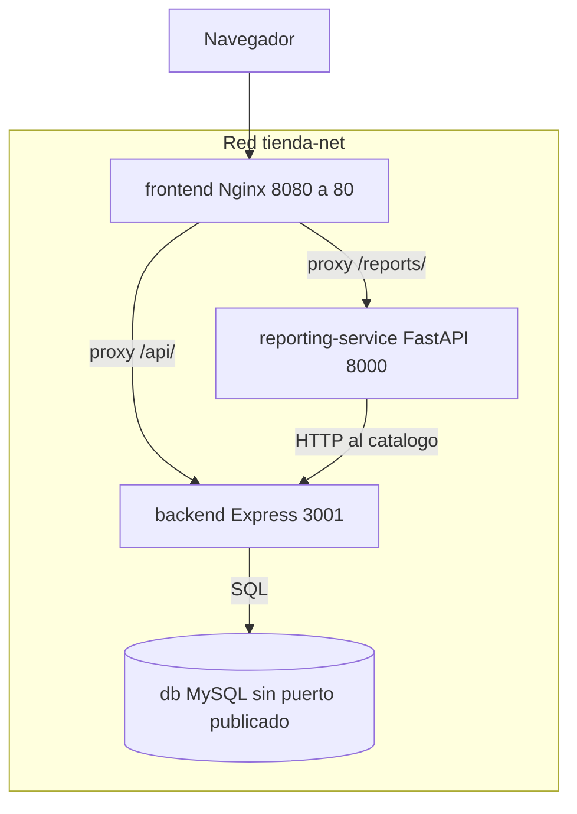

# Tienda de Alimentos para Perritos

Aplicación de gestión de inventario para una tienda de alimentos de perros. Está dividida en cuatro servicios y se ejecuta con Docker Compose. La integración y el despliegue se automatizan con GitHub Actions.

La documentación de evidencias de la Evaluación Parcial 2 está en [docs/EVIDENCIAS-EVP2.md](docs/EVIDENCIAS-EVP2.md).

## Descripción del proyecto

El problema es administrar el catálogo y, al mismo tiempo, consultar el estado del inventario sin mezclar esas responsabilidades en un solo proceso. La tienda necesita altas, cambios y bajas de productos, y un reporte que resuma unidades, valor y los productos con poco stock o mayor valor.

El objetivo es operar esa tienda como microservicios, con pruebas automáticas, controles de seguridad y un despliegue simulado que solo corre después de un CI exitoso del mismo commit.

Funcionalidades:

- Listar, crear, editar y eliminar productos desde `/productos`.
- Consultar el reporte de inventario en `/reporte`: resumen, stock bajo (umbral 5) y los cinco productos de mayor valor.
- Si el servicio de reportería no está disponible, la página de productos sigue respondiendo. El reporte muestra el mensaje «No se pudieron obtener los reportes. Revisá reporting-service o reintentá.» y el botón **Reintentar**.

## Arquitectura

| Servicio | Tecnología | Rol |
| --- | --- | --- |
| `frontend` | Nginx 1.27, HTML, CSS y JavaScript | Páginas y proxy inverso |
| `backend` | Node.js 18 y Express | CRUD de productos y acceso a MySQL |
| `reporting-service` | Python 3.12 y FastAPI | Cálculo de reportes a partir del catálogo |
| `db` | MySQL 8.4 | Persistencia de `productos` |

El navegador habla solo con Nginx. `/api/` se reenvía a Express y `/reports/` a FastAPI. FastAPI no abre conexión a MySQL: pide el catálogo a Express (`BACKEND_URL=http://backend:3001`) y arma el resumen, el stock bajo y el ranking. Express es el único servicio que consulta la base.

La raíz `/` responde `302` a `/productos`. La redirección es relativa (`absolute_redirect off`) porque el contenedor escucha en el puerto 80 y el host publica el 8080. `/reporte` no se confunde con el prefijo de API `/reports/`.



Cadena de arranque: MySQL healthy, después Express, y desde Express arrancan FastAPI y el frontend. El frontend no espera a FastAPI. No hay dependencia circular.

## Docker y orquestación

Cada servicio tiene su Dockerfile:

- `frontend/Dockerfile` copia las páginas, los scripts y `default.conf` sobre Nginx. Los estáticos quedan sin permiso de escritura.
- `backend/Dockerfile` instala solo dependencias de producción (`npm ci --omit=dev`) y ejecuta `node server.js` con un usuario no root.
- `reporting-service/Dockerfile` usa `python:3.12.8-slim-bookworm`, instala `requirements.txt` y arranca Uvicorn con un usuario no root. Las dependencias de prueba no entran en la imagen.
- `db/Dockerfile` parte de `mysql:8.4` y copia `db/init.sql`. Ese script corre solo cuando el volumen se crea por primera vez. La imagen no contiene contraseñas.

`docker-compose.yml` los une en la red `tienda-net`. El volumen `mysql-data` guarda `/var/lib/mysql`. Cambiar el usuario o la contraseña en `.env` no modifica un volumen que ya fue inicializado.


## Pruebas automatizadas

| Suite | Dónde | Qué cubre | Umbral |
| --- | --- | --- | --- |
| Jest y Supertest | `backend/tests/productos.test.js` | CRUD y health, con MySQL simulado | 80 % en `backend/jest.config.js` |
| PyTest | `reporting-service/tests/` | Salud, cliente HTTP y reportes | `--cov-fail-under=80` en `reporting-service/pytest.ini` |
| E2E | `scripts/e2e-reporting.sh` | Nginx, Express, FastAPI y MySQL en Compose | El script sale distinto de cero si algo no coincide |

El archivo de pruebas del backend define 19 casos `it`. Los tests de reportería definen 20 funciones `test_`. Esos conteos coinciden con el CI del push a `develop` del commit `62b229a` ([run 41023485335](https://github.com/jaimelunalarcon/DOYO101-005V/actions/runs/41023485335)):

- Jest: 19 passed. Cobertura de `server.js`: 93,15 % líneas, 94,28 % ramas y 81,81 % funciones.
- PyTest: 20 passed. Cobertura de líneas del paquete `app`: 100 %. El umbral configurado es 80 %.
- E2E del job `docker-build`: `E2E_OK` con `productos=5 unidades=113 low=0 top=5`. Ese inventario es el de `db/init.sql` sobre un volumen nuevo. El script no exige una cantidad fija: compara el listado de Express con los totales del reporte.

Comandos locales:

```bash
cd backend
npm ci
npm test
npm run test:coverage
```

```bash
cd reporting-service
python3.12 -m pip install -r requirements-dev.txt
pytest -v
```

La imagen de producción instala solo `requirements.txt`. `requirements-dev.txt` agrega `pytest==9.1.1`, `pytest-asyncio==1.4.1` y `pytest-cov==6.0.0`. Esos dos runners se actualizan juntos.

Con el stack ya levantado:

```bash
bash scripts/e2e-reporting.sh
```

El script espera cuatro servicios healthy y no detiene contenedores ni borra volúmenes.

## CI — Integración continua

El workflow [`.github/workflows/ci.yml`](.github/workflows/ci.yml) se llama `CI`. Corre en push a `develop` y en pull requests hacia `develop` o `main`.

Jobs:

1. `tests-backend` y `tests-reporting` instalan dependencias y publican la cobertura.
2. `security-scan` corre en paralelo: `npm audit --audit-level=high`, `pip-audit` sobre `requirements.txt` y Trivy.
3. `sonarqube-analysis` depende de los dos jobs de tests. Normaliza las rutas de LCOV y Cobertura y escanea con SonarCloud.
4. `docker-build` depende de tests, security-scan y Sonar. Valida la estructura, ejecuta `docker compose config` y `docker compose build`, levanta los cuatro servicios y corre `scripts/e2e-reporting.sh` con `TIMEOUT_SEC=180`. Después, también si falló, ejecuta `docker compose down --remove-orphans --volumes` en el runner.

La espera del Quality Gate (`sonar.qualitygate.wait`) está activa en pull requests y en `main`. En un push a `develop` el análisis igual se ejecuta, pero la espera queda desactivada por una limitación de SonarCloud Free. En el PR 32 el gate sí se esperó y el log registró `QUALITY GATE STATUS: PASSED`.

En el mismo push `62b229a`, `security-scan` terminó en success. `npm audit` informó 6 vulnerabilidades low en el árbol de Jest y no falló, porque el umbral es high. `pip-audit` informó `No known vulnerabilities found` para `requirements.txt`. Trivy, en severidad HIGH y CRITICAL, informó 0 hallazgos en `backend/package-lock.json` y en `reporting-service/requirements.txt`. Trivy omite dependencias de desarrollo en ese escaneo.

## DevSecOps

Estos controles no reemplazan la revisión del código. Cortan el pipeline o abren un PR cuando aparece un cambio inseguro.

- **Dependabot** (`.github/dependabot.yml`) revisa cada lunes npm en `/backend`, pip en `/reporting-service` y GitHub Actions en `/`. Los PR se abren contra `develop`. `pytest` y `pytest-asyncio` van en el grupo `python-test-runners` para no actualizarlos por separado. Dependabot lee esta configuración desde la rama por defecto.
- **SonarQube Cloud** analiza backend, frontend, reporting-service y `db`. El Quality Gate del PR bloquea el merge si el código nuevo no cumple el perfil del proyecto. El JavaScript del navegador se analiza, pero está en `sonar.coverage.exclusions` porque no tiene suite unitaria: lo ejercita la prueba E2E. Si entrara en la cobertura nueva, el gate vería 0 %.
- **Trivy** falla el job ante vulnerabilidades HIGH o CRITICAL sin fix ignorado. Un resumen LOW y MEDIUM se imprime y no bloquea.
- **npm audit** falla solo desde severidad high en el backend.
- **pip-audit** recorre las dependencias de producción de Python, directas y transitivas, y falla ante cualquier vulnerabilidad conocida de ese grafo.
- **Docker:** puertos mínimos, red interna para MySQL, usuarios no root, filesystem de solo lectura, capabilities reducidas donde el proceso lo permite, límites de recursos y secretos fuera de las imágenes.

## CD — Despliegue continuo

[`.github/workflows/cd.yml`](.github/workflows/cd.yml) despliega en el runner de GitHub Actions. No hay un servidor de producción permanente: al terminar, el runner se destruye.

El disparo automático es `workflow_run` del workflow `CI`, solo si ese CI fue un push a `develop` y terminó en `success`. Un pull request, una rama feature o un CI fallido no despliegan. El checkout usa el SHA de ese CI, no un `develop` posterior. GitHub ejecuta este `workflow_run` con el archivo que está en `main`; el código desplegado es el SHA validado.

La ejecución manual es `workflow_dispatch` y solo está autorizada en `develop`. Antes de construir, consulta la API de Actions y se detiene si ese SHA no tiene un CI de push a `develop` en success.

Pasos de `deploy-simulated`: validar el SHA del checkout, `docker compose config`, build, `up`, `scripts/e2e-reporting.sh`, informe en el resumen del job, artifact `deployment-report` (retención 14 días) y `docker compose down --remove-orphans --volumes`. La limpieza corre siempre y solo dentro del runner. El informe anota SHA, rama, id de ejecución, hora UTC, estado de los pasos y la salida E2E. No incluye contraseñas.

Evidencia en Actions:

- Manual, [run 41018834026](https://github.com/jaimelunalarcon/DOYO101-005V/actions/runs/41018834026): `workflow_dispatch` sobre `develop`, commit autorizado `11431ef`, job de 07:14:13 a 07:15:13 UTC (un minuto) y `E2E_OK` con 5 productos, 113 unidades, 0 de stock bajo y top 5.
- Automático, [run 41023747647](https://github.com/jaimelunalarcon/DOYO101-005V/actions/runs/41023747647): `workflow_run` tras el CI de push `62b229a`. El log del job registra `Commit autorizado: 62b229a9823284ac853f261ba4b4803685a74640` y el mismo `E2E_OK`. La ficha del run muestra la rama `main` porque `workflow_run` usa el workflow de la rama por defecto; el commit desplegado es el del log.
- El [run 41023751211](https://github.com/jaimelunalarcon/DOYO101-005V/actions/runs/41023751211) quedó skipped: lo disparó el CI del pull request, y la condición exige `event == push`.

## Instrucciones de ejecución

1. Instalar Docker y el plugin Compose.
2. Clonar el repositorio y usar la rama `develop` para integración, o `main` para el release ya publicado.
3. Crear `.env` como se indica en [Levantar, verificar y detener](#levantar-verificar-y-detener).
4. Abrir la aplicación en el navegador.

| Destino | URL |
| --- | --- |
| Productos | http://127.0.0.1:8080/productos |
| Reporte | http://127.0.0.1:8080/reporte |
| API de productos, vía Nginx | http://127.0.0.1:8080/api/productos |
| Health de Express, vía Nginx | http://127.0.0.1:8080/api/health |
| Reportes, vía Nginx | http://127.0.0.1:8080/reports/summary |
| Stock bajo | http://127.0.0.1:8080/reports/low-stock?threshold=5 |
| Mayor valor | http://127.0.0.1:8080/reports/top-value?limit=5 |
| Express directo | http://127.0.0.1:3001/api/health |
| FastAPI directo | http://127.0.0.1:8000/health |

`GET`, `POST`, `PUT` y `DELETE` de `/api/productos` están implementados en `backend/server.js`. Un producto lleva `nombre`, `descripcion`, `precio` y `stock`.

## Estructura del repositorio

```text
├── .github/dependabot.yml
├── .github/workflows/ci.yml
├── .github/workflows/cd.yml
├── backend/                 # Express, Jest y Dockerfile
├── db/                      # MySQL 8.4 e init.sql
├── docs/EVIDENCIAS-EVP2.md  # Evidencias de la entrega
├── frontend/                # Nginx, páginas y proxy
├── reporting-service/       # FastAPI, PyTest y Dockerfile
├── scripts/e2e-reporting.sh
├── docker-compose.yml
├── sonar-project.properties
├── .env.example
└── README.md
```

## Modelo de ramas

El repositorio usa GitFlow. `main` es el release, `develop` integra el trabajo, y las features entran por pull request.

```text
feature/*  ──PR──►  develop  ──PR──►  main
```

Un hotfix se abre desde la rama afectada y, si entra a `main`, también se sincroniza con `develop`. Los mensajes de commit van en español y dicen qué se corrige o por qué.

## Uso de herramientas de inteligencia artificial

Durante el desarrollo del proyecto utilicé herramientas de inteligencia artificial, principalmente Cursor, como apoyo en la implementación de código, configuración de Docker y GitHub Actions, creación de pruebas automatizadas y resolución de problemas técnicos, facilitando el proceso de desarrollo y permitieron optimizar los tiempos de implementación. Las soluciones fueron revisadas y validadas mediante pruebas funcionales, ejecución de contenedores y resultados de los pipelines CI/CD.

Su utilización también contribuyó a reforzar mis conocimientos sobre microservicios, automatización, seguridad y despliegue de aplicaciones.

# Reflexión Personal

En lo personal, si bien ya tenía conocimientos de algunas de las herramientas utilizadas durante el proyecto, considero muy importante reforzar continuamente mis conocimientos en el área de DevOps.

Uno de los aspectos más enriquecedores fue el área de seguridad, que representó un aprendizaje nuevo para mí. La integración de distintas herramientas de análisis y seguridad me permitió comprender cómo estas se complementan y por qué son fundamentales para garantizar la calidad y seguridad durante el desarrollo de software.
